<p align="center">
  <picture>
    <source media="(prefers-color-scheme: dark)" srcset=".github/assets/banner-dark.svg">
    <source media="(prefers-color-scheme: light)" srcset=".github/assets/banner-light.svg">
    
  </picture>
</p>

<p align="center">
  <a href="USAGE.md">Usage</a> &nbsp;·&nbsp; <a href="repo/examples/xwift/README.md">Sample</a> &nbsp;·&nbsp; <a href="https://github.com/xwift-org">Org profile</a>
</p>

One look across the org. The org profile and every repository README share the same artwork, palette and structure.

`repo/render.py` reads a TOML config and writes `README.md`, plus a banner, a divider and a footer band in light and dark. The artwork is generated from the Xwift palette and seeded by the repository name. `org/profile/` holds the org profile. [`USAGE.md`](USAGE.md) explains both.

<p align="center">
  <picture>
    <source media="(prefers-color-scheme: dark)" srcset=".github/assets/divider-dark.svg">
    <source media="(prefers-color-scheme: light)" srcset=".github/assets/divider-light.svg">
    
  </picture>
</p>

## Install

```sh
git clone https://github.com/xwift-org/readme-template.git
cd readme-template
```

## Usage

```sh
python3 repo/render.py repo repo/examples/xwift/xwift.toml
python3 repo/render.py org --org xwift-org --out /tmp/xwift-profile
```

```text
wrote repo/examples/xwift/README.md and repo/examples/xwift/.github/assets/banner-{light,dark}.svg
wrote org assets to /tmp/xwift-profile/assets and README for xwift-org
```

## Platforms

Python 3.11 or later. Standard library only. No fonts are embedded.

## Status

In use for the [xwift-org](https://github.com/xwift-org) profile. The sample in `repo/examples/xwift/` renders the toolchain README.

## Contributing

1. Change `art.py` for primitives and `artwork.py` for compositions.
2. Render the org profile and the sample, and check both in light and dark.
3. Keep the trademark line at the end of every README.

## License

Not chosen yet.

<p align="center">
  <picture>
    <source media="(prefers-color-scheme: dark)" srcset=".github/assets/footer-dark.svg">
    <source media="(prefers-color-scheme: light)" srcset=".github/assets/footer-light.svg">
    
  </picture>
</p>

<sub>Xwift is an independent project. It is not affiliated with or endorsed by Apple Inc. Swift is a trademark of Apple Inc.</sub>
