<p align="center">
  <picture>
    <source media="(prefers-color-scheme: dark)" srcset=".github/assets/banner-dark.svg">
    <source media="(prefers-color-scheme: light)" srcset=".github/assets/banner-light.svg">
    
  </picture>
</p>

<p align="center">
  <a href="USAGE.md">Usage</a> &nbsp;·&nbsp;
  <a href="repo/examples/xwift/README.md">Sample</a> &nbsp;·&nbsp;
  <a href="https://github.com/xwift-org">Org profile</a>
</p>

One look across the org, taken from swift.org: the same type scale, spacing, colours and section rhythm, with original Xwift artwork and copy.

`repo/render.py` reads a TOML config and writes `README.md` plus every block as an SVG in light and dark: the banner, section headers, code cards, swoops and the closing band with the footer. Text in the SVGs is outlined from Inter, so nothing depends on installed fonts. `org/profile/` holds the org profile. [`USAGE.md`](USAGE.md) explains both, and [`swiftorg-spec.md`](swiftorg-spec.md) lists the measured swift.org values.

<a id="install"></a>
<p align="center">
  <picture>
    <source media="(prefers-color-scheme: dark)" srcset=".github/assets/section-install-dark.svg">
    <source media="(prefers-color-scheme: light)" srcset=".github/assets/section-install-light.svg">
    
  </picture>
</p>

```sh
git clone https://github.com/xwift-org/readme-template.git
cd readme-template
```

<a id="usage"></a>
<p align="center">
  <picture>
    <source media="(prefers-color-scheme: dark)" srcset=".github/assets/section-usage-dark.svg">
    <source media="(prefers-color-scheme: light)" srcset=".github/assets/section-usage-light.svg">
    
  </picture>
</p>

```sh
python3 repo/render.py repo repo/examples/xwift/xwift.toml
python3 repo/render.py org --org xwift-org --out /tmp/xwift-profile
```

```text
wrote repo/examples/xwift/README.md and repo/examples/xwift/.github/assets/
wrote /tmp/xwift-profile/README.md and /tmp/xwift-profile/assets/ for xwift-org
```

<a id="platforms"></a>
<p align="center">
  <picture>
    <source media="(prefers-color-scheme: dark)" srcset=".github/assets/section-platforms-dark.svg">
    <source media="(prefers-color-scheme: light)" srcset=".github/assets/section-platforms-light.svg">
    
  </picture>
</p>

Python 3.11 or later. Standard library only. No fonts are embedded; text is outlined from `brand/glyphs.json`.

<a id="status"></a>
<p align="center">
  <picture>
    <source media="(prefers-color-scheme: dark)" srcset=".github/assets/section-status-dark.svg">
    <source media="(prefers-color-scheme: light)" srcset=".github/assets/section-status-light.svg">
    
  </picture>
</p>

Renders the [xwift-org](https://github.com/xwift-org) profile. The sample in `repo/examples/xwift/` renders the toolchain README.

<a id="contributing"></a>
<p align="center">
  <picture>
    <source media="(prefers-color-scheme: dark)" srcset=".github/assets/section-contributing-dark.svg">
    <source media="(prefers-color-scheme: light)" srcset=".github/assets/section-contributing-light.svg">
    
  </picture>
</p>

1. Change `art.py` for primitives and `artwork.py` for compositions. Keep swift.org's measured values from `swiftorg-spec.md`.
2. Render the org profile and the sample, and check both in light and dark.
3. Keep the trademark line at the end of every README.

<a id="license"></a>
<p align="center">
  <picture>
    <source media="(prefers-color-scheme: dark)" srcset=".github/assets/section-license-dark.svg">
    <source media="(prefers-color-scheme: light)" srcset=".github/assets/section-license-light.svg">
    
  </picture>
</p>

Not chosen yet.

<p align="center">
  <a href="mailto:vido.teodor10@gmail.com"><picture>
    <source media="(prefers-color-scheme: dark)" srcset=".github/assets/closing-dark.svg">
    <source media="(prefers-color-scheme: light)" srcset=".github/assets/closing-light.svg">
    
  </picture></a>
</p>

<sub>Xwift is an independent project. It is not affiliated with or endorsed by Apple Inc. Swift is a trademark of Apple Inc.</sub>
