<p align="center">
  <picture>
    <source media="(prefers-color-scheme: dark)" srcset="./assets/hero-dark.svg">
    <source media="(prefers-color-scheme: light)" srcset="./assets/hero-light.svg">
    
  </picture>
</p>

<p align="center">
  <a href="#get-started">Get started</a> &nbsp;·&nbsp;
  <a href="#projects">Projects</a> &nbsp;·&nbsp;
  <a href="#community">Community</a> &nbsp;·&nbsp;
  <a href="#contributing">Contributing</a>
</p>

<p align="center">
  <picture>
    <source media="(prefers-color-scheme: dark)" srcset="./assets/platforms-dark.svg">
    <source media="(prefers-color-scheme: light)" srcset="./assets/platforms-light.svg">
    
  </picture>
</p>

Xwift is a universal cross-platform toolchain, UI framework and system APIs. It is built on its own fork of Swift and LLVM, which the Xwift project owns and modifies. One source tree targets macOS, Windows, Linux, Android, iOS and Web.

<p align="center">
  <picture>
    <source media="(prefers-color-scheme: dark)" srcset="./assets/divider-a-dark.svg">
    <source media="(prefers-color-scheme: light)" srcset="./assets/divider-a-light.svg">
    
  </picture>
</p>

## Get started

The proof of concept is one package. It builds, tests and runs the same way on every target in CI.

```sh
git clone https://github.com/{{ORG}}/xwift.git
cd xwift
swift build
swift test
swift run xwift-hello
```

```swift
import XwiftCore

print(greeting())
```

```text
Hello from Xwift on linux-x86_64 (64-bit)!
```

## Projects

<p align="center">
  <picture>
    <source media="(prefers-color-scheme: dark)" srcset="./assets/projects-dark.svg">
    <source media="(prefers-color-scheme: light)" srcset="./assets/projects-light.svg">
    
  </picture>
</p>

- **[xwift](https://github.com/{{ORG}}/xwift)**: the compiler and toolchain.
- **[xwift-ui](https://github.com/{{ORG}}/xwift-ui)**: the UI framework.
- **[xwift-system](https://github.com/{{ORG}}/xwift-system)**: the system APIs.
- **[xwift-pm](https://github.com/{{ORG}}/xwift-pm)**: the package manager.

<p align="center">
  <picture>
    <source media="(prefers-color-scheme: dark)" srcset="./assets/divider-b-dark.svg">
    <source media="(prefers-color-scheme: light)" srcset="./assets/divider-b-light.svg">
    
  </picture>
</p>

## Community

- Questions and ideas: open an issue in the repository it concerns.
- Bugs: open an issue in the repository it belongs to, with the target and the toolchain version.
- Releases and notes: each repository's Releases page.

## Contributing

1. Install the toolchain pinned in `.swift-version`.
2. `swift build && swift test` must pass locally.
3. Open a pull request against `main`. CI must be green on every target.
4. Keep commits focused, with imperative-mood messages.

Licenses are set per repository. The toolchain license is not chosen yet.

<p align="center">
  <picture>
    <source media="(prefers-color-scheme: dark)" srcset="./assets/footer-dark.svg">
    <source media="(prefers-color-scheme: light)" srcset="./assets/footer-light.svg">
    
  </picture>
</p>

<sub>Xwift is an independent project. It is not affiliated with or endorsed by Apple Inc. Swift is a trademark of Apple Inc.</sub>
