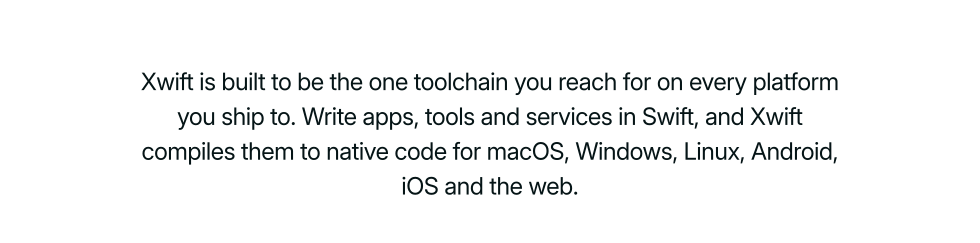
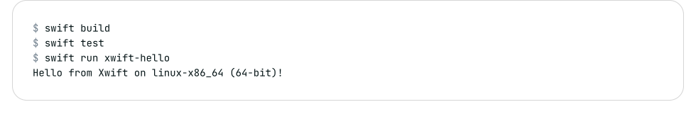
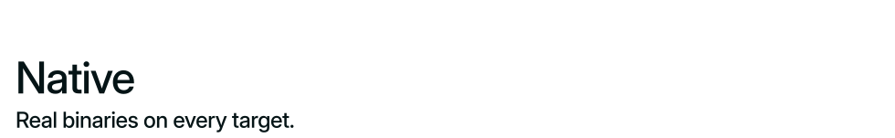
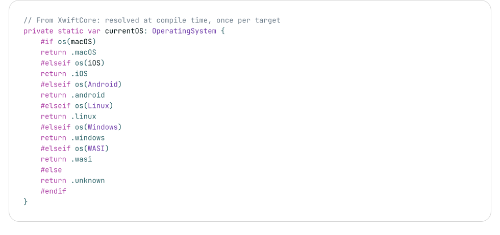

  <picture>
    <source media="(prefers-color-scheme: dark)" srcset="./assets/hero-dark.svg">
    <source media="(prefers-color-scheme: light)" srcset="./assets/hero-light.svg">
    
  </picture>

  <a href="#overview">Overview</a> &nbsp;·&nbsp;
  <a href="#projects">Projects</a> &nbsp;·&nbsp;
  <a href="#status">Status</a> &nbsp;·&nbsp;
  <a href="#contact">Contact</a>

  <picture>
    <source media="(prefers-color-scheme: dark)" srcset="./assets/intro-dark.svg">
    <source media="(prefers-color-scheme: light)" srcset="./assets/intro-light.svg">
    
  </picture>

  <picture>
    <source media="(prefers-color-scheme: dark)" srcset="./assets/callout-universal-dark.svg">
    <source media="(prefers-color-scheme: light)" srcset="./assets/callout-universal-light.svg">
    
  </picture>

Xwift compiles one Swift codebase for desktop, mobile and the web. The proof of concept already builds, tests and runs on macOS, Linux, Windows and WebAssembly in CI. Android and iOS come next.

  <picture>
    <source media="(prefers-color-scheme: dark)" srcset="./assets/code-universal-dark.svg">
    <source media="(prefers-color-scheme: light)" srcset="./assets/code-universal-light.svg">
    
  </picture>

  <picture>
    <source media="(prefers-color-scheme: dark)" srcset="./assets/callout-native-dark.svg">
    <source media="(prefers-color-scheme: light)" srcset="./assets/callout-native-light.svg">
    
  </picture>

Xwift compiles straight to native code through LLVM. No virtual machine and no bridge sit between your code and the platform. What you ship is a plain native binary.

  <picture>
    <source media="(prefers-color-scheme: dark)" srcset="./assets/code-native-dark.svg">
    <source media="(prefers-color-scheme: light)" srcset="./assets/code-native-light.svg">
    
  </picture>

  <picture>
    <source media="(prefers-color-scheme: dark)" srcset="./assets/callout-owned-dark.svg">
    <source media="(prefers-color-scheme: light)" srcset="./assets/callout-owned-light.svg">
    
  </picture>

Xwift keeps its own fork of the Swift compiler, driver, package manager and installer scripts. Today the fork matches Swift 6.4.1 with no patches. Every other dependency is pinned to an exact commit, so each build can be reproduced.

  <picture>
    <source media="(prefers-color-scheme: dark)" srcset="./assets/code-owned-dark.svg">
    <source media="(prefers-color-scheme: light)" srcset="./assets/code-owned-light.svg">
    
  </picture>

  <picture>
    <source media="(prefers-color-scheme: dark)" srcset="./assets/swoop-1-dark.svg">
    <source media="(prefers-color-scheme: light)" srcset="./assets/swoop-1-light.svg">
    
  </picture>

  <picture>
    <source media="(prefers-color-scheme: dark)" srcset="./assets/callout-familiar-dark.svg">
    <source media="(prefers-color-scheme: light)" srcset="./assets/callout-familiar-light.svg">
    
  </picture>

Xwift speaks the Swift language and SwiftPM. Packages, tests and skills carry over unchanged, and the fork is synced from upstream Swift releases.

  <picture>
    <source media="(prefers-color-scheme: dark)" srcset="./assets/code-familiar-dark.svg">
    <source media="(prefers-color-scheme: light)" srcset="./assets/code-familiar-light.svg">
    
  </picture>

  <picture>
    <source media="(prefers-color-scheme: dark)" srcset="./assets/callout-projects-dark.svg">
    <source media="(prefers-color-scheme: light)" srcset="./assets/callout-projects-light.svg">
    
  </picture>

The toolchain comes first. A UI framework, system APIs and a package manager follow, each in its own repository.

- **Toolchain.** The compiler, driver and package manager, forked from Swift 6.4.1. Private, in Phase 0.
- **UI framework.** One declarative UI for every target. Planned.
- **System APIs.** Files, networking, processes and devices, the same everywhere. Planned.
- **Package manager.** Packages and a registry for all six targets. Planned.

  <picture>
    <source media="(prefers-color-scheme: dark)" srcset="./assets/section-status-dark.svg">
    <source media="(prefers-color-scheme: light)" srcset="./assets/section-status-light.svg">
    
  </picture>

- **Phase 0 is done.** Private mirrors of the Swift compiler, driver, package manager and installer scripts, plus a reproducible build setup.
- **The proof of concept runs.** One package builds, tests and runs on macOS, Linux, Windows and WebAssembly in CI.
- **Not released.** There is no public toolchain, no website and no download yet. The source repositories are private.
- **License.** Not chosen yet.

  <picture>
    <source media="(prefers-color-scheme: dark)" srcset="./assets/section-contact-dark.svg">
    <source media="(prefers-color-scheme: light)" srcset="./assets/section-contact-light.svg">
    
  </picture>

Write to [vido.teodor10@gmail.com](mailto:vido.teodor10@gmail.com). Watch [xwift-org](https://github.com/xwift-org) for the first public repositories.

  <a href="mailto:vido.teodor10@gmail.com"><picture>
    <source media="(prefers-color-scheme: dark)" srcset="./assets/closing-dark.svg">
    <source media="(prefers-color-scheme: light)" srcset="./assets/closing-light.svg">
    
  </picture></a>

Xwift is an independent project. It is not affiliated with or endorsed by Apple Inc. Swift is a trademark of Apple Inc.
