<p align="center">
  <picture>
    <source media="(prefers-color-scheme: dark)" srcset=".github/assets/banner-dark.svg">
    <source media="(prefers-color-scheme: light)" srcset=".github/assets/banner-light.svg">
    
  </picture>
</p>

<p align="center">
  <a href="#install">Get started</a> &nbsp;·&nbsp; <a href="#platforms">Platforms</a> &nbsp;·&nbsp; <a href="#status">Status</a> &nbsp;·&nbsp; <a href="#contributing">Contributing</a>
</p>

The toolchain is the base of Xwift. It is Xwift's own fork of Swift and LLVM, modified by the Xwift project to target macOS, Windows, Linux, Android, iOS and Web from one source tree.

This repository starts as the proof of concept: one package, one source tree, built and run on four targets in CI. The fork replaces the stock toolchain in a later stage.

<p align="center">
  <picture>
    <source media="(prefers-color-scheme: dark)" srcset=".github/assets/divider-dark.svg">
    <source media="(prefers-color-scheme: light)" srcset=".github/assets/divider-light.svg">
    
  </picture>
</p>

## Install

```sh
git clone https://github.com/xwift-org/xwift.git
cd xwift
swift build
swift test
```

## Usage

```sh
swift run xwift-hello
```

```text
Hello from Xwift on linux-x86_64 (64-bit)!
```

## Platforms

| Platform | Status | Notes |
| --- | --- | --- |
| macOS | working | CI: build, test, run |
| Windows | working | CI: build, test, run |
| Linux | working | CI: build, test, run |
| Android | planned | Not in CI yet |
| iOS | planned | Not in CI yet |
| Web | working | WebAssembly (WASI). CI: build, run |

## Status

Proof of concept. `swift build`, `swift test` and `swift run xwift-hello` run in CI on macOS, Linux, Windows and WebAssembly (WASI). Android and iOS are not in CI yet.

## Contributing

1. Install the toolchain pinned in `.swift-version`.
2. `swift build && swift test` must pass locally.
3. Open a pull request against `main`. CI must be green on every target.
4. Keep commits focused, with imperative-mood messages.

## License

Not chosen yet. See `LICENSE`.

<p align="center">
  <picture>
    <source media="(prefers-color-scheme: dark)" srcset=".github/assets/footer-dark.svg">
    <source media="(prefers-color-scheme: light)" srcset=".github/assets/footer-light.svg">
    
  </picture>
</p>

<sub>Xwift is an independent project. It is not affiliated with or endorsed by Apple Inc. Swift is a trademark of Apple Inc.</sub>
