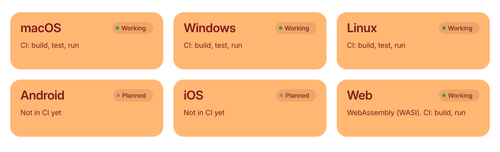

<p align="center">
  <picture>
    <source media="(prefers-color-scheme: dark)" srcset=".github/assets/banner-dark.svg">
    <source media="(prefers-color-scheme: light)" srcset=".github/assets/banner-light.svg">
    
  </picture>
</p>

<p align="center">
  <a href="#install">Get started</a> &nbsp;·&nbsp;
  <a href="#platforms">Platforms</a> &nbsp;·&nbsp;
  <a href="#status">Status</a> &nbsp;·&nbsp;
  <a href="#contributing">Contributing</a>
</p>

The toolchain is the base of Xwift. It is planned as Xwift's own fork of Swift and LLVM, targeting macOS, Windows, Linux, Android, iOS and the web from one source tree.

This repository is the proof of concept: one package, one source tree, built and run on four targets in CI with stock Swift 6.4.1. The fork replaces the stock toolchain in a later phase. The repository is private for now.

<a id="install"></a>
<p align="center">
  <picture>
    <source media="(prefers-color-scheme: dark)" srcset=".github/assets/section-install-dark.svg">
    <source media="(prefers-color-scheme: light)" srcset=".github/assets/section-install-light.svg">
    
  </picture>
</p>

```sh
git clone https://github.com/xwift-org/xwift.git
cd xwift
swift build
swift test
```

<a id="usage"></a>
<p align="center">
  <picture>
    <source media="(prefers-color-scheme: dark)" srcset=".github/assets/section-usage-dark.svg">
    <source media="(prefers-color-scheme: light)" srcset=".github/assets/section-usage-light.svg">
    
  </picture>
</p>

```sh
swift run xwift-hello
```

```text
Hello from Xwift on linux-x86_64 (64-bit)!
```

<a id="platforms"></a>
<p align="center">
  <picture>
    <source media="(prefers-color-scheme: dark)" srcset=".github/assets/section-platforms-dark.svg">
    <source media="(prefers-color-scheme: light)" srcset=".github/assets/section-platforms-light.svg">
    
  </picture>
</p>

<p align="center">
  <picture>
    <source media="(prefers-color-scheme: dark)" srcset=".github/assets/platforms-dark.svg">
    <source media="(prefers-color-scheme: light)" srcset=".github/assets/platforms-light.svg">
    
  </picture>
</p>

<a id="status"></a>
<p align="center">
  <picture>
    <source media="(prefers-color-scheme: dark)" srcset=".github/assets/section-status-dark.svg">
    <source media="(prefers-color-scheme: light)" srcset=".github/assets/section-status-light.svg">
    
  </picture>
</p>

Proof of concept. `swift build`, `swift test` and `swift run xwift-hello` run in CI on macOS, Linux, Windows and WebAssembly (WASI). Android and iOS are not in CI yet.

<a id="contributing"></a>
<p align="center">
  <picture>
    <source media="(prefers-color-scheme: dark)" srcset=".github/assets/section-contributing-dark.svg">
    <source media="(prefers-color-scheme: light)" srcset=".github/assets/section-contributing-light.svg">
    
  </picture>
</p>

1. Install the toolchain pinned in `.swift-version`.
2. `swift build && swift test` must pass locally.
3. Open a pull request against `main`. CI must be green on every target.
4. Keep commits focused, with imperative-mood messages.

<a id="license"></a>
<p align="center">
  <picture>
    <source media="(prefers-color-scheme: dark)" srcset=".github/assets/section-license-dark.svg">
    <source media="(prefers-color-scheme: light)" srcset=".github/assets/section-license-light.svg">
    
  </picture>
</p>

Not chosen yet. See `LICENSE`.

<p align="center">
  <a href="mailto:vido.teodor10@gmail.com"><picture>
    <source media="(prefers-color-scheme: dark)" srcset=".github/assets/closing-dark.svg">
    <source media="(prefers-color-scheme: light)" srcset=".github/assets/closing-light.svg">
    
  </picture></a>
</p>

<sub>Xwift is an independent project. It is not affiliated with or endorsed by Apple Inc. Swift is a trademark of Apple Inc.</sub>
